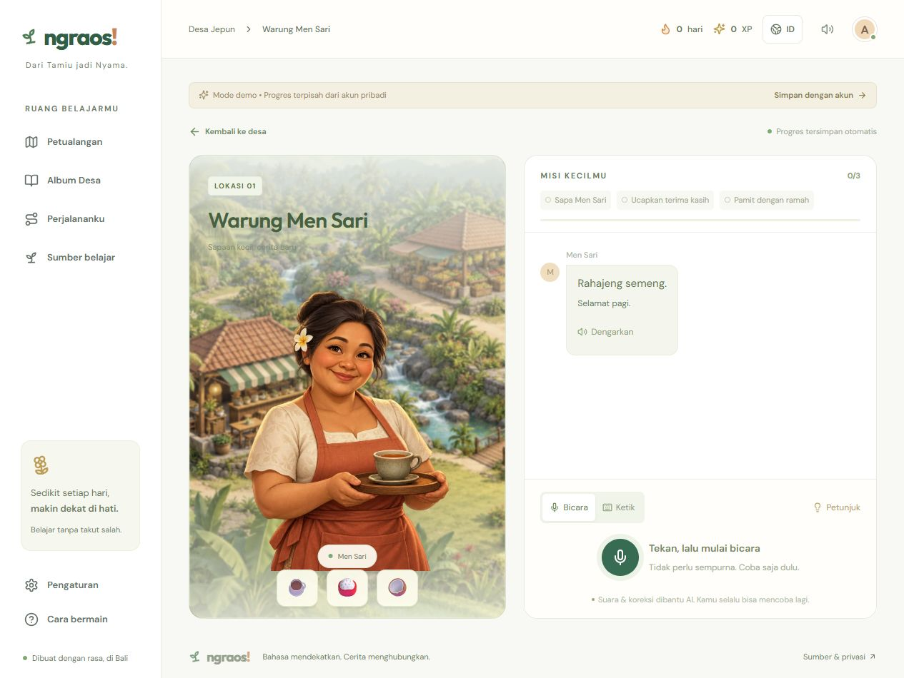
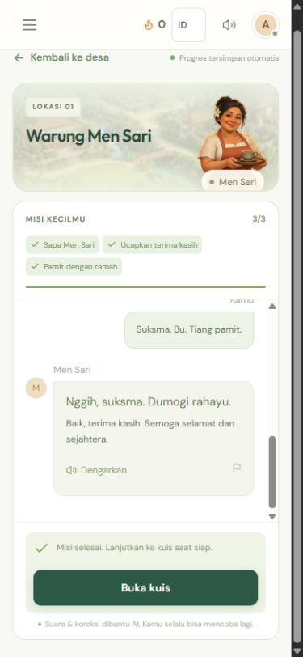
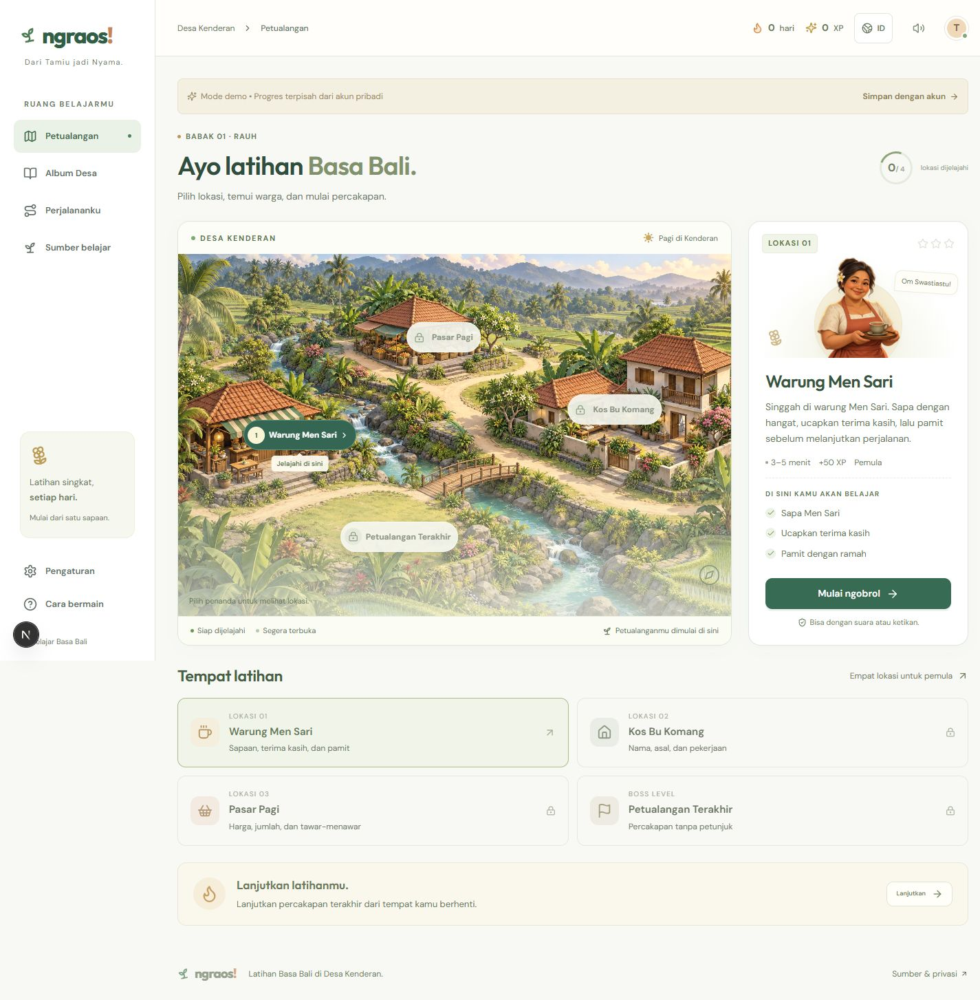

# Ngraos gameplay and UI audit — Desa Kenderan

Release: **20261031-v2.2-ux**, 2026-10-31. Scope: the existing village, conversation, voice, quiz, progress, album, sources, settings, and their responsive layouts. “Dari Tamiu jadi Nyama” is preserved.

## Flow findings and changes

1. **Choose a location — improved.** On phones the selected location and start button now appear before the large map. Location cards use readable titles and full-width rows. Desktop and tablet share consistent type, card spacing and button sizes. The village is called Desa Kenderan throughout the UI.
2. **Talk to a resident — improved.** The old objective matcher rejected “Om swastiastu” and quantities such as “kalih biu”. It now accepts these natural variants while still checking the model's evidence against the player's actual utterance. Dialogue history is sent as conversation turns. Missed objectives from older sessions can be recovered from the player’s actual earlier words; NPC-only statements cannot grant progress. The NPC answers orders/questions, remembers names and prices, accepts code-switching, and can say goodbye without forcing the mission script. Corrections remain separately grounded in sources.
3. **Speak and hear a reply — improved.** Tap the microphone once. After at least 250 ms of detected speech and a 1.5-second pause, recording ends and the transcript is submitted automatically. The manual stop remains available; silence is not sent. Review-before-send is optional. Opening and reply audio autoplay after gesture unlock. Recording, transcription, thinking, audio preparation and playback have distinct states. Failed submissions retain the text and retry ID.
4. **Finish the conversation and take the quiz — improved.** Automatic quiz navigation previously stopped the final audio. The final reply now plays completely; the learner chooses when to open the quiz. Listening questions autoplay. If two generated quizzes fail content validation, a checked source-derived quiz is built using real mistakes or explicitly labelled reinforcement. Technical provider failures still offer retry and never become learner mistakes.
5. **Review progress and preferences — improved.** Album, sources, profile and progress share heading sizes, readable body text, touch targets and card spacing. Mobile dictionaries use one column. Hidden mobile navigation is inert, Escape closes the menu, keyboard focus stays inside the open sheet, and switching to desktop closes it.
6. **Copy and character feedback — improved.** Generic slogans such as “Langkah kecil, cerita baru”, “Bukan sekadar kata” and “Nyaman dengan caramu” were replaced with task-specific text. The painted portrait is completely still: the duplicate mouth image, jaw transform and body sway are removed. A speaking badge and small audio-responsive halo communicate playback; reduced-motion preferences suppress the pulse.

## Screenshots captured during this audit

Before: the initial conversation depended on a separate Listen control and manual transcript/send steps.

After: compact phone scene and independently scrolling conversation, with automatic voice sending available by default.

After: desktop layout and copy use the same components and spacing.

[Phone map and start card](04-map-mobile-after.png) · [Settings](06-settings-desktop.jpg)

## Verification

- **39/39** unit and PostgreSQL integration tests passed, including 20-player persistence, reward idempotency, flexible objective matching, checked fallback quizzes, and speech/pause detection.
- **21 browser tests passed; 6 skipped.** Four skipped tests require media APIs absent in the Windows WebKit port; two avoid duplicating the explicit layout matrix across projects. The matrix covers **320, 390, 760, 768, 1024 and 1440 px**. Chromium tests capture real synthetic audio, submit automatically without a stop/send click, play real WAV audio, verify the portrait has no transform or duplicate mouth, and prove final audio is not interrupted by a quiz.
- Real OpenRouter conversations and quizzes passed for **all four locations**. The market remembered two bananas and negotiated its earlier price; the host retained the learner's name and hometown. The public Warung regression also passed after deployment. Transcripts are in [conversation-all-levels.json](conversation-all-levels.json) and [conversation-production.json](conversation-production.json).
- Production build and TypeScript passed. Release deployment created a database backup, ran migrations/seed, and reported app/database healthy.

## Evidence limits

Screenshots establish visual states, not full accessibility compliance or linguistic accuracy. Synthetic browser audio is not a physical iPhone/Android microphone test. AI replies remain variable; the sample dialogues demonstrate relevance and continuity, not a promise of human-level Balinese fluency. Existing provider timeouts and rate limits remain recoverable service errors. Latency figures from the original release are historical, not new performance guarantees for this revision.

Production browser follow-up: the public matrix passed 20 cases and had one WebKit page-load/hydration timeout, with six explicit skips. The isolated retry of that case passed in 4.9 seconds. The complete local matrix passed 21 cases without failures. The server-history regression adds a 39th unit/database test.

Final quiz follow-up: all three browser engines passed the new incomplete-word-order guard (3/3 additional cases), bringing verified browser cases to 24. The live mobile journey recovered its historical greeting, completed all five quiz questions, and saved the result.

[Mobile quiz screenshot](07-quiz-mobile.jpg).

Live mobile result: 5/5 quiz answers, 3 stars, +170 XP and next location unlocked. [Result screenshot](08-result-mobile.jpg). The final word-order control passed on all three browser engines through public HTTPS.
