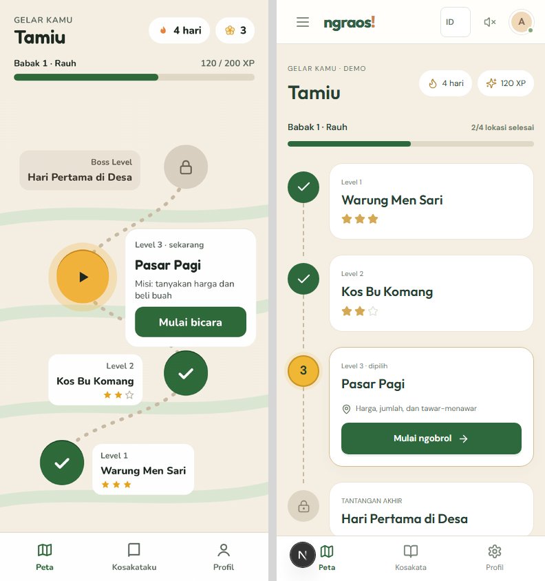
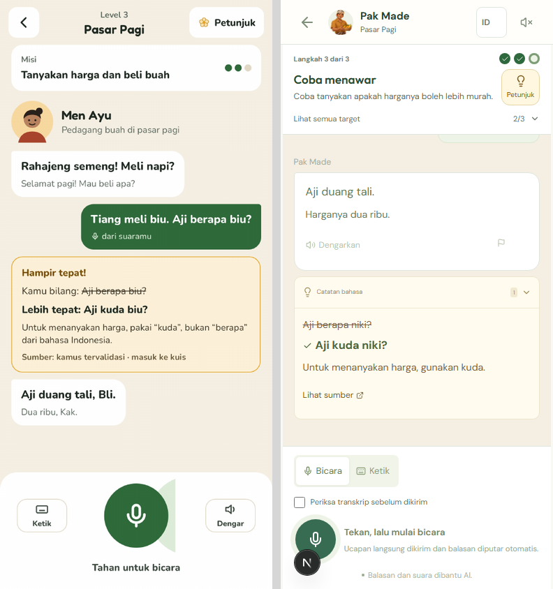
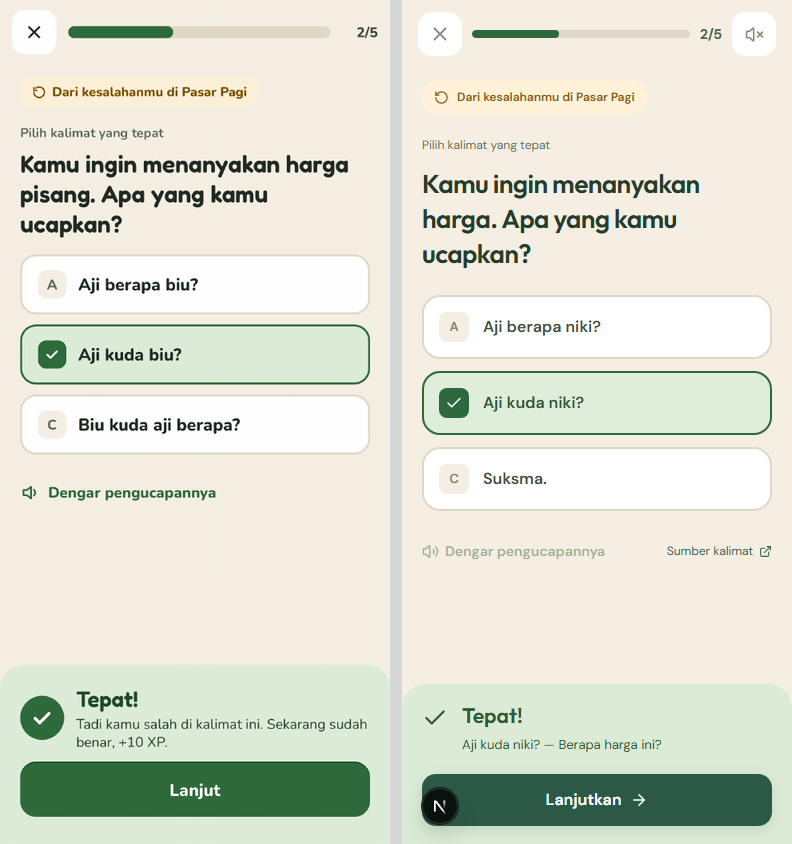
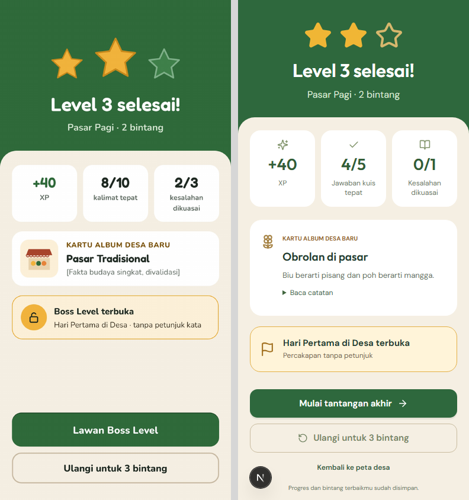

# Guided gameplay from the application mockup

Release: `20261101-v4-guided-gameplay`.

The supplied four-page PDF is the visual reference for the mobile learning path, guided conversation, checked quiz and result/unlock flow. The working application's NPCs, source corpus, real reward rules, Desa Kenderan and “Dari Tamiu jadi Nyama” are retained. [Visual comparison and iteration report](../../design-qa.md).

## Player-facing changes

- The current objective now explains what to say. Directions remain visible and do not count as hints. A response that does not advance a goal receives a visible, neutral explanation.
- Optional example phrases come from the eligible authored corpus. The star restriction is explained before revealing one. Each reveal is stored once per objective, including concurrent requests and refresh. “Pakai dan sesuaikan” fills the text box without sending it. The final challenge shows directions without answer examples.
- Phone navigation now shows an ordered path, completed stars, the selected lesson, real chapter progress, a resume action and a map/vocabulary/profile dock. The illustration map remains available through a disclosure; the full village stays visible on desktop.
- The latest language correction opens inline. The corrected phrase is emphasized, and a concise source link replaces internal provenance wording.
- Each quiz answer is checked and stored before feedback appears. The expected answer is exposed only after that question is checked. Choice, word-order and listen/repeat questions support retry and resume. Errors use clear text and a retry icon. Technical failures preserve inputs.
- Results show real XP, quiz score, unique practiced mistakes mastered (or correction-free turns if no mistakes were practiced), the album note, and a direct next/replay action. Album details expand separately so the unlock remains easy to see.
- Session changes remount the player to clear stale drafts, notices and audio state. Existing still portraits and speaking indicators are preserved.

## Persistence and operational changes

Additive migration adds `game_sessions.revealed_hints` and `game_sessions.quiz_answers`. Existing turns, stars, profiles and rewards are retained. A new owned `/api/sessions/:id/answer` endpoint stores the first answer transactionally. Completion uses those saved answers even if a later client attempts to submit a different one. Existing completion requests remain compatible.

No new AI provider, key, model or third-party service is introduced. The existing OpenRouter adapters, recording handling, secret exclusion, backups and Docker deployment remain in use.

## Verification

- TypeScript passed.
- **53/53 unit/PostgreSQL tests passed**, including concurrent hint reveals, canonical examples, private unchecked answers, persistent first answers, reward idempotency and unique mistake mastery.
- **56 local browser checks passed, 10 explicit skips, zero failures** across Chromium desktop/mobile and Windows WebKit. Four skips concern unavailable WebKit media APIs; six avoid repeating screenshot/viewport matrices. The focused final comparison capture also passed.
- A real-backend manual Warung conversation advanced through all objectives, generated five reinforcement questions, retained a deliberately incorrect first answer, finalized 4/5 quiz answers and two stars after an example, and immediately started Kos. Protected phrase audio completed without a visible error. These captures are distinct from the deterministic comparison fixtures.
- Source/reference comparisons use controlled Pasar fixture data at 390 × 844. Fixture XP, corrections and quiz results are visual test data, not evidence of live model quality. They never enter production player data.

Physical Android Chrome/iOS Safari recording remains a separate device check. Windows WebKit media limitations and duplicate viewport/capture skips are explicit in the browser report. AI/source checks are consistency checks, not expert or native-speaker validation. Previous production load and latency measurements are historical; this UI release does not claim a new benchmark.

## Production verification

Deployed to `https://ngraos.docker.anatera.app` as `20261101-v4-guided-gameplay`. The production Docker build, TypeScript and standalone secret-file check passed; both app and PostgreSQL are healthy. The additive migration and corpus seed completed after backup `ngraos-20261101T011245Z.dump` was created and its checksum verified. Both new columns exist; no environment file is present in the running image.

- **25 HTTPS browser checks passed, two duplicate capture skips, zero failures.** These cover real fresh-demo hint persistence and resume, and fixture-based guided quiz/next/replay flows across Chromium and WebKit. The actual public browser preserved a pre-existing demo's 280 XP, best stars and active completed conversation. No message was added to that existing conversation.
- An isolated **real-OpenRouter production probe passed all eight checks**: concurrent canonical hint reveal, actual mission progression, private unchecked answers, first-answer persistence after retry/resume, five saved answers, protected checked-answer WAV, idempotent concurrent completion, and starting Kos. [Machine-readable results](production-check.json). The probe deliberately submitted one wrong answer and arbitrary later selections; its quiz score is a transport/scoring check, not a learning-quality benchmark. Its temporary demo was deleted.
- The public phone map and old-session recovery were inspected in the chosen browser with no console errors. [Phone path](production-path.jpg), [resumed conversation](production-conversation.jpg).

To repeat the paid integration probe with a fresh isolated demo:

```sh
node scripts/check-guidance.mjs https://ngraos.docker.anatera.app
```

The helper records only aggregate checks/results. It never writes an authentication cookie, provider secret or audio recording to the report.

## Evidence

Reference comparisons (source left, implementation right):






Actual-backend manual session: [completed conversation](04-conversation-complete-local.jpg), [quiz](05-quiz-local.jpg), [result](08-result-local.jpg), [next location](09-next-location-local.jpg), [hint policy](10-hint-policy-local.jpg), [desktop conversation](12-desktop-conversation-local.jpg), [desktop village](13-desktop-map-local.jpg).

Earlier screenshots are retained as before-fix evidence. `reference-*.png` are the final deterministic UI fixtures; they should not be confused with real-provider screenshots.
