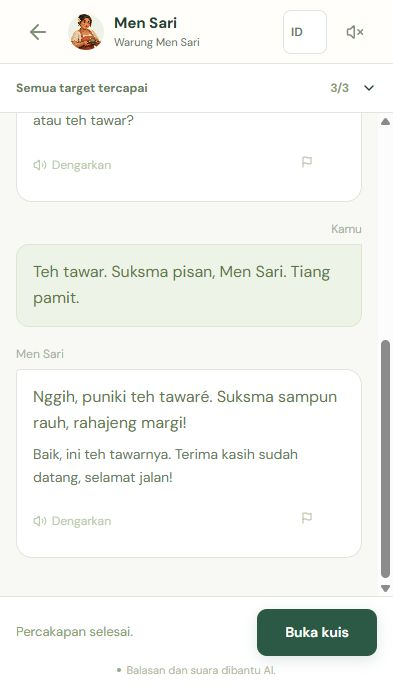
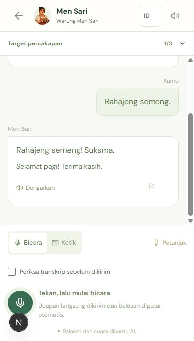

# Mobile conversation and unexpected-script fix

Release: `20261101-v3.2-mobile-chat`.

The supplied iPhone photo showed that the large scene, expanded mission tracker and stacked completion card consumed most of the available conversation viewport. It also showed a Han character inside a generated Balinese reply. The previous schema validated JSON shape and string length but did not validate the writing system of generated learning text.

## Changes

- On phones the large scene and duplicate back/title row are replaced by the NPC identity in the application header. XP and profile controls leave this conversation header; language and sound remain available. The character stays still; playback uses a speaking label and small halo.
- Mission details are collapsed by default. The summary shows the completed count and can be opened with touch or keyboard.
- Conversation history uses the remaining visual viewport, with full-width readable NPC messages, 16 px dialogue, 14 px translations and a compact quiz action. Player text is preserved.
- Generated replies, translations, corrections and quiz text are checked for Latin letters, including Balinese diacritics. Invalid roleplay output receives one repair attempt; a second invalid output fails without committing learner progress. Foreign-script legacy replies are withheld and cannot reach TTS or be repeated as assistant context.
- Existing bad replies can be repaired through an ownership-checked endpoint. This only updates the reply and translation, retaining turn ID, player wording, mission evidence, hints, quiz, rewards and scores. Concurrent repair requests reuse the same result.

## Production repair

The deployment created a database backup before updating the application. The dry-run maintenance script found **one** affected stored reply. Applying the repair reported **one repaired, zero failed**. A second scan reported **zero affected replies**. Raw text and credentials were not printed by the maintenance script.

The repair script defaults to a read-only scan:

```sh
docker compose run --rm --no-deps migrate node --import tsx scripts/repair-legacy-replies.ts
```

Append `--apply` to repair detected replies using the configured OpenRouter model. Each candidate is rechecked inside its owned session transaction.

## Verification

- **48/48** unit/PostgreSQL checks passed, including exact script contamination, diacritics, one retry, fail-closed behavior, untouched player transcription, TTS blocking and concurrent repair without reassessment.
- Local browser regression: **40 passed, 8 explicitly skipped**, across Chromium desktop/mobile and Windows WebKit.
- Focused public HTTPS regression: **11 passed, 1 explicitly skipped**, including the photo-like completed state, retrying a failed repair, goal expansion, controls on short screens and synthetic voice playback.
- The completed mobile fixture requires history to occupy more than **55% of a 393 × 690 viewport**, rather than checking overflow alone. Other checks cover 320 × 568, 390 × 667, 390 × 844 and a 390 × 380 viewport for keyboard space.
- TypeScript, the production Docker build and application/database health passed.
- A real public conversation ordered tea and ended with thanks and a farewell. All three goals completed; validated replies used Latin letters with a Balinese diacritic. History measured **483 px of a 690 px viewport (70%)** in this completed state.

WebKit's Windows media APIs cause the explicit media skips. These checks include simulated phone/keyboard viewports, not a new physical iPhone microphone or Safari toolbar certification. The user-provided photo remains the evidence of the original physical-device issue.

Verified public completed conversation:



Local active conversation preview:


