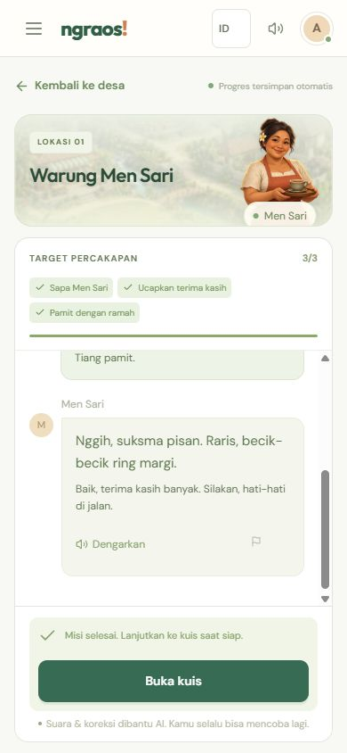
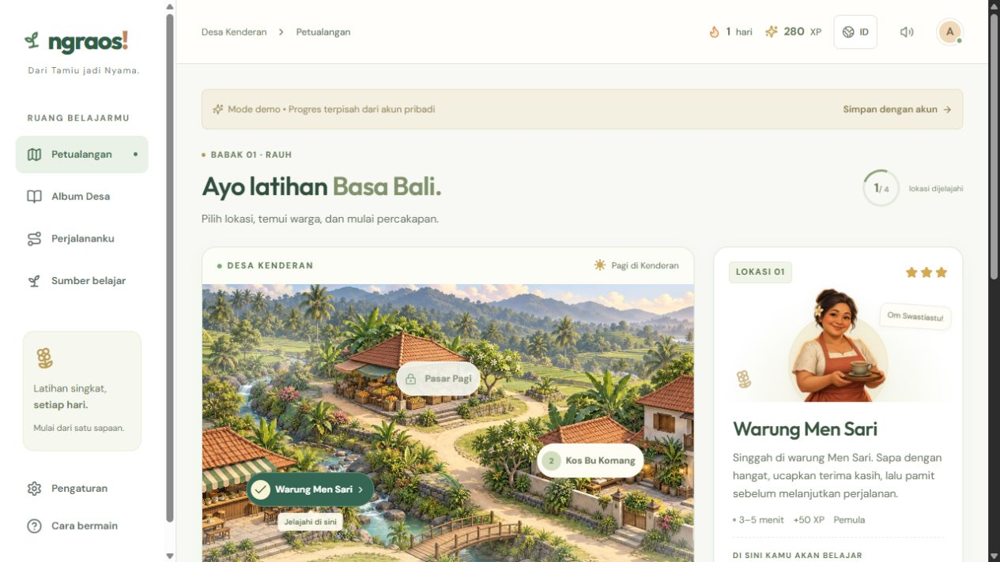

# Audit UI/UX Ngraos — Desa Kenderan

Rilis perbaikan: `20261031-v3.1-responsive`. Audit pada 31 Oktober 2026 melalui browser dalam aplikasi Codex, di domain publik dan pratinjau lokal. Tujuan: pemain dapat memilih lokasi, bercakap, menyelesaikan kuis, dan melihat progres dengan nyaman di ponsel maupun desktop. Identitas “Dari Tamiu jadi Nyama” dipertahankan.

## Alur yang diperiksa

1. **Halaman pembuka — baik.** Tujuan aplikasi, tiga langkah bermain, dan tombol Mulai terlihat jelas. Bahasa Indonesia/Inggris, keyboard, Back, dan pengurangan animasi tersedia. [Tampilan desktop](../welcome/desktop-production.jpg).
2. **Pilih lokasi — diperbaiki.** Kartu lokasi terpilih mendahului peta di ponsel. Header sekarang menampilkan identitas Ngraos dan kontrol penting dengan target sentuh 44 px. Angka streak tetap tersedia di halaman progres; header ponsel lebih ringkas. [Desktop final](17-village-desktop-final.jpg), [ponsel sebelum penyesuaian header](03-village-mobile-before.jpg).
3. **Percakapan — diperbaiki.** Tinggi area mengikuti visual viewport. Riwayat bergulir sendiri; layar pendek memakai ilustrasi lebih ringkas. Saat ruang sangat pendek, ilustrasi dan label tambahan disembunyikan agar kolom kirim tetap terjangkau. Lukisan karakter diam; indikator suara dan halo menunjukkan aktivitas. [Sebelum](08-conversation-mobile-before.jpg), [sesudah pada produksi](11-conversation-mobile-production.jpg).
4. **Kuis dan hasil — lulus.** Sesi publik berhasil menyelesaikan lima soal dengan nilai 5/5, tiga bintang dan tambahan 110 XP untuk pengulangan latihan. Pilihan jawaban menyampaikan status terpilih. Progres kuis memiliki nama dan nilai bagi pembaca layar. Kuis susun kata tetap menunggu semua kata ditempatkan. [Kuis](12-quiz-mobile-production.jpg), [hasil tersimpan](13-result-mobile-production.jpg).
5. **Album dan progres — baik.** Kartu, judul, dan jarak konsisten dengan halaman lain. Kisi menjadi satu kolom pada ponsel; angka XP, streak dan bintang tetap terbaca. [Album](07-album-mobile-before.jpg), [progres](04-progress-mobile-before.jpg).
6. **Kamus dan sumber — diperbaiki.** Pencarian yang kosong sebelumnya langsung melompat ke blok Privasi tanpa memberi tahu bahwa tidak ada hasil. Kini ada jumlah hasil, pesan “Kata belum ditemukan”, saran pencarian, dan tombol untuk melihat semua kata. [Sebelum](06-search-empty-before.jpg), [sesudah](14-search-mobile-production.jpg).
7. **Profil, pengaturan, dan navigasi — diperbaiki.** Tombol suara dan animasi memiliki nama serta status switch. Dialog memakai judul sebagai nama aksesibel. Menu ponsel mengunci gulir dan latar belakang, membatasi fokus, serta mengembalikan fokus ketika ditutup. Fokus berpindah ke konten setelah memilih halaman. Pengaturan aktif juga ditandai di navigasi. [Profil ponsel](05-settings-mobile-before.jpg), [pengaturan desktop final](16-settings-desktop-production.jpg).

## Temuan utama dan perbaikan

| Prioritas | Bukti | Masalah | Perbaikan |
| --- | --- | --- | --- |
| Tinggi | Langkah 3, uji 320 × 568 | Ukuran minimum percakapan membuat composer melewati bagian bawah layar | Tinggi mengikuti visual viewport, flex dapat menyusut, ilustrasi dan rincian diringkas pada layar pendek |
| Tinggi | Langkah 7, pengujian keyboard | Fokus kembali ke tombol ketika latarnya masih inert | Fokus dikembalikan setelah React memperbarui latar; Escape dan pemilihan halaman diuji |
| Sedang | Langkah 7, uji muat ulang | Effect penyimpanan bisa menimpa preferensi suara/animasi sebelum selesai dibaca | Tunda penyimpanan sampai preferensi selesai dimuat; kegagalan storage tidak memutus aplikasi |
| Sedang | Langkah 6, tangkapan pencarian kosong | Tidak ada penjelasan atau jalan pemulihan saat kata tidak ditemukan | Status jumlah hasil, pesan kosong, dan tombol reset pencarian |
| Sedang | Langkah 3 dan 7, pemeriksaan komponen | Catatan koreksi kecil; tombol pengaturan hanya berbunyi “Aktif/Mati” | Teks koreksi 12–13 px, target kontrol 44 px, label dan status aksesibel |
| Rendah | Langkah 2–7 | Header ponsel kurang menunjukkan identitas dan salinan bantuan kurang langsung | Logo ringkas, kontrol lebih lega, teks tugas spesifik, nama Desa Kenderan konsisten |

## Bukti layar

Percakapan publik sesudah perbaikan:

Desktop mempertahankan peta dan kartu lokasi yang sejajar:

## Verifikasi dan batas bukti

TypeScript dan build Docker produksi lulus. Container aplikasi/database sehat. Pengujian browser mencakup lebar 320–1440 px, tinggi ponsel 568–844 px dan viewport pendek 380 px, navigasi keyboard, status pengaturan, pencarian kosong, percakapan, audio sintetis, kuis, refresh, dan transisi halaman pembuka.

Hasil akhir pada HTTPS produksi: **37 kasus browser lulus, 8 dilewati secara eksplisit, 0 gagal**. Empat skip berasal dari API media yang tidak tersedia pada WebKit Windows; empat menghindari duplikasi matriks ukuran layar. Seluruh **39 tes unit dan PostgreSQL** lulus. Sesi manual publik juga lulus hingga hasil kuis tersimpan. Rilis membuat backup database sebelum migrasi dan pergantian container.

Tangkapan layar diterima setelah file tersimpan dibuka dan diperiksa. Posisi kontrol pada viewport pendek dibuktikan oleh pengujian geometri browser. Pemeriksaan ini tidak menyatakan kepatuhan WCAG penuh. Keyboard dan mikrofon perangkat iPhone/Android fisik belum diuji pada audit ini. WebKit Windows tidak menyediakan beberapa API media; alasan skip dilaporkan secara eksplisit. Kualitas bahasa Bali tidak disimpulkan dari audit tata letak.
