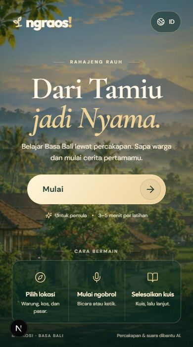
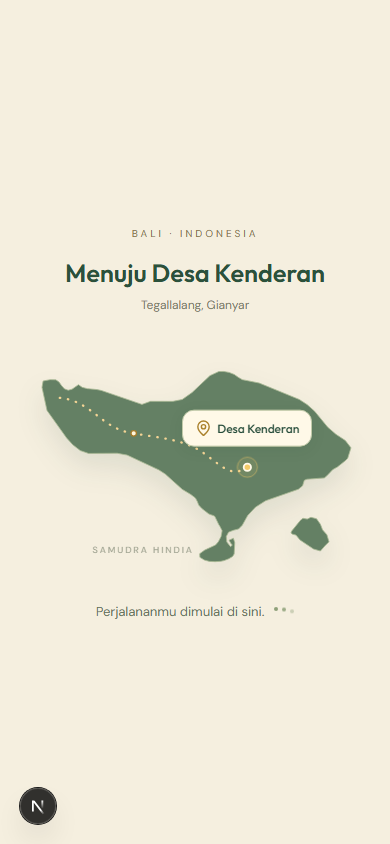

# One-screen welcome and Bali arrival

Release: `20261101-v4.1-welcome-journey`.

Scope follows the user's clarification: **the main welcome screen only**, plus the transition from Mulai into Desa Kenderan. The guided conversation, learning path, quiz and result designs retain the preceding release's behavior. The village application adds only a readiness signal for the entry transition.

## Changes

- The familiar landscape, serif heading, gold Mulai button and **Dari Tamiu jadi Nyama** remain. The introduction, start action, three how-to-play steps and disclosure now fit one normal-sized phone viewport. The old scroll arrow and long stacked tutorial are replaced by a compact three-column guide.
- Dynamic viewport height and safe-area padding keep the footer within the usable screen. The phone height adjustments include 320 × 568, 375 × 667 and 390 × 700; tablets, desktop and a short landscape view are also checked. Enlarged content may scroll inside the main region for accessibility.
- Mulai immediately begins navigation under a persistent, animated Bali map. A bright point follows the dotted route to the geographically projected Kenderan marker, the destination pulses, then the map zooms toward Kenderan and dissolves into the village.
- The overlay survives the route change and waits for the village's profile/loading request to finish. The arrival animation takes about 2.5 seconds on a ready page; reduced motion uses a brief static transition. There are no invented progress percentages. A long wait provides reload/back actions; returning during a transition restores an enabled Mulai button.
- Background controls are inert while entering. The new page receives keyboard focus after the overlay is removed. Animation frames and timers are cleaned up on unmount.
- The map is a 1.8 KB local SVG derived from public-domain Natural Earth coastline data. No map SDK, runtime map request or geolocation permission is added. [Geographic sources and asset credits](../assets.md#bali-arrival-map).

## Visual QA

The user's two iPhone photos are the before-state evidence: a long main screen and a mostly blank loading view. The redesign preserves the approved art direction while changing layout density and the loading interaction. These photos include Safari/device chrome; they are not a same-viewport pixel-match target.

Reviewed actual browser captures: [390 × 700 welcome](local-phone.jpg), [1440 × 900 desktop](local-desktop.jpg), and [390 × 844 journey](journey-phone.png). The last is a deterministic browser capture with the profile request held so the actual animated component can be inspected; it is not a rendered mock image. Its point movement is also measured through SVG geometry in the test.

Fidelity surfaces: the same Cormorant/DM Sans/Outfit fonts and existing landscape assets remain; spacing uses one viewport instead of a long vertical stack; ivory/gold/forest tokens carry through the map; the new SVG uses real coastline data with a documented projection; copy retains concrete three-step instructions in Indonesian and English. Primary controls stay at least 44 px.

Resolved during verification: background art initially created a phantom scrollbar despite fitting content; the outer scene now clips its decorative overdraw while the content region can scroll when needed. The initial moving point used an inconsistent SVG animation timeline; a cleaned-up animation-frame path follower now starts on the actual path and passes geometry checks in Chromium and WebKit. Focus is restored after the inert state is removed, rather than before the React commit.

final result: passed

## Verification

TypeScript passed. Full local regression: **60 passed, 12 explicit skips, zero failures** across Chromium desktop/mobile and Windows WebKit. Four skips concern unavailable Windows WebKit media APIs; eight avoid duplicate viewport/capture/recovery matrices. Focused welcome checks also passed: **11 passed, four explicit duplicate-matrix/recovery skips**. They cover both languages, all content fitting in one screen at nine viewport sizes, actual point movement, waiting for readiness, reduced motion, focus restoration, reload, back during entry and slow-load recovery. Production results follow below.

No new live AI requests or learning-content changes are needed for this feature. Desktop/phone browser simulations are not physical iPhone/Safari toolbar certification.

## Production

`20261101-v4.1-welcome-journey` is running at `https://ngraos.docker.anatera.app/`. The Docker production build, TypeScript and standalone secret-file exclusion passed. Both the app and PostgreSQL are healthy. Deployment's pre-update database backup `ngraos-20261101T013730Z.dump` passed checksum verification; this feature has no schema migration or reward/data changes.

HTTPS welcome verification: **11 passed, four explicit duplicate-matrix/recovery skips, zero failures** across Chromium desktop/mobile and WebKit. This repeats the nine-size ID/EN one-screen matrix, real rendered point movement, delayed-readiness recovery, reduced motion, reload and back-during-entry assertions against production assets.

The chosen browser also opened the public root, measured a 390 × 700 page with no document or content overflow (main client/scroll heights both 580 px; footer bottom 700 px), selected Mulai, and reached the village. The browser console had no warnings or errors. No learning message or quiz answer was submitted in that manual check. [Production main screen](production-phone.jpg), [early crossfade frame](production-entry.jpg), [production-asset route animation test frame](production-journey.png). The test frame holds the browser's profile response for observation and does not change production player data.

